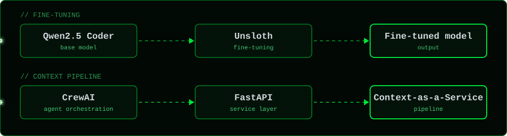
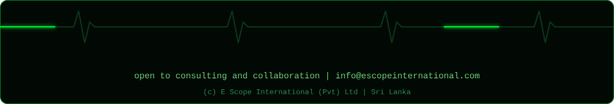

 

  

I'm the CEO and Founder of [E Scope International (Pvt) Ltd](https://escopeinternational.com), a Sri Lanka–based software company building business management systems, AI-driven platforms, and smart agriculture solutions. I still build hands-on: full-stack development, POS architecture, cloud sync infrastructure, and product design across web, desktop, and mobile, deployed on **AWS**.

  

Recent work includes fine-tuning **Qwen2.5 Coder** with Unsloth and building a **Context-as-a-Service** pipeline with CrewAI and FastAPI.

 

  

 

  

 

  

  

  

